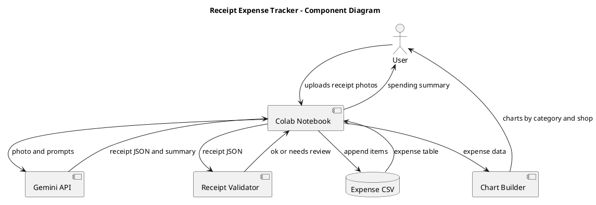
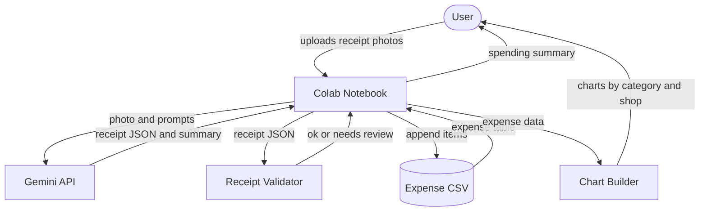
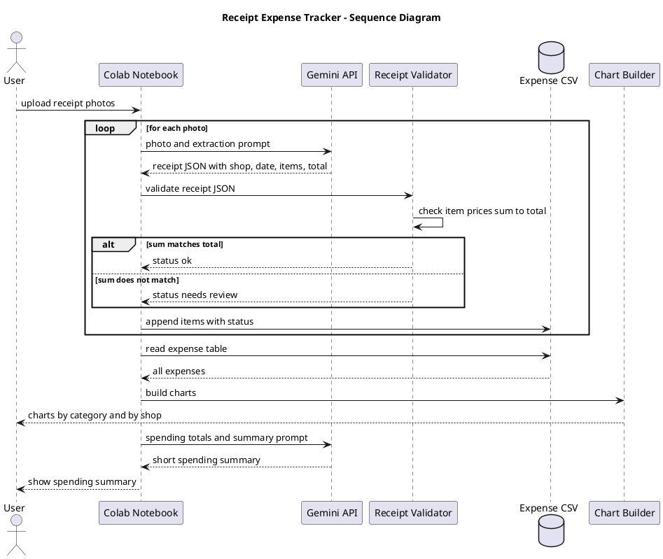
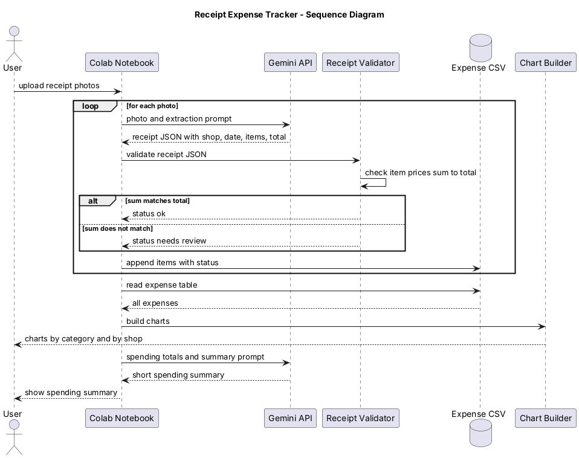
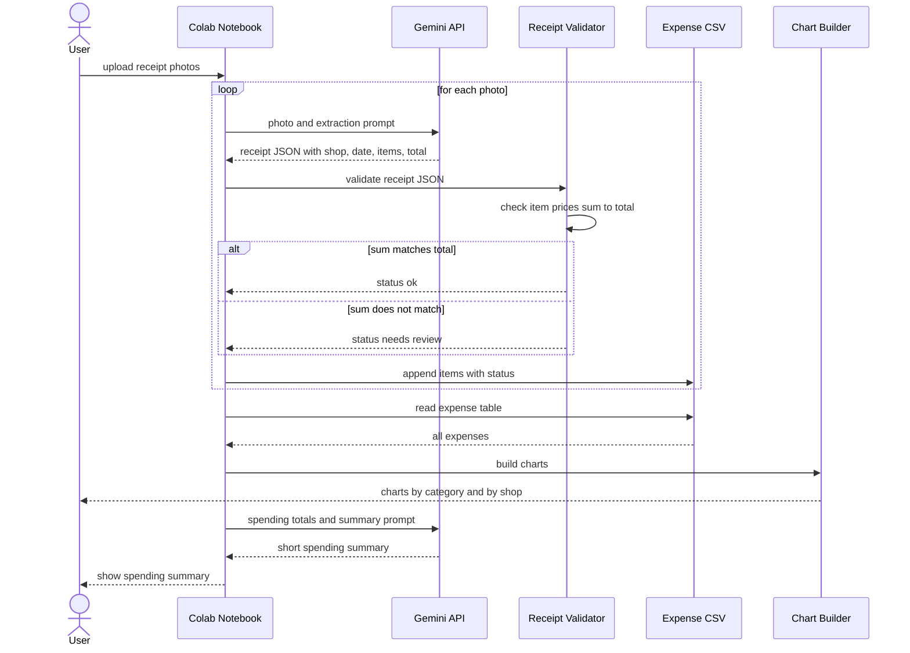

# Receipt Expense Tracker

Receipt Expense Tracker is a Google Colab notebook that takes photos of shop
receipts, uses the Google Gemini API to read the items and prices, validates
that the item prices add up to the receipt total, stores the results in a CSV
expense table, and charts and summarises spending.

## UML

### Component diagram

#### PlantUML

#### Rendered diagram

#### Mermaid

### Sequence diagram

#### PlantUML

#### Rendered diagram

#### Mermaid

